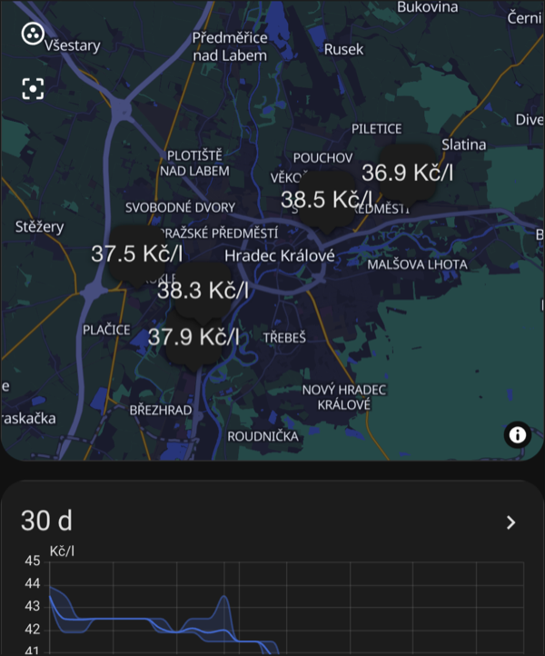
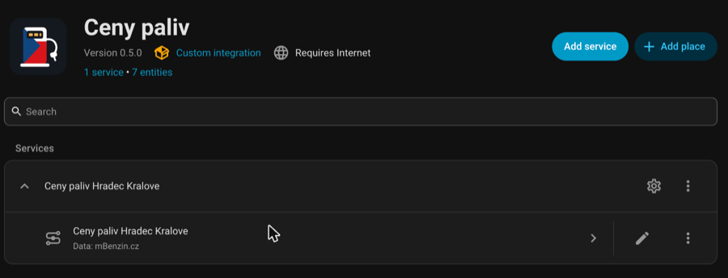
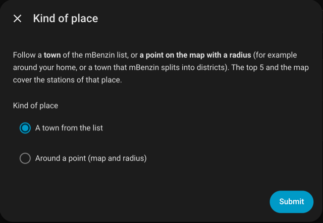
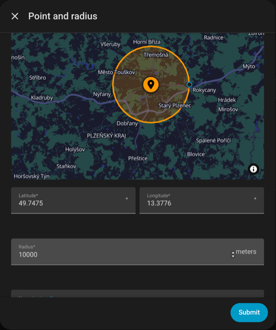
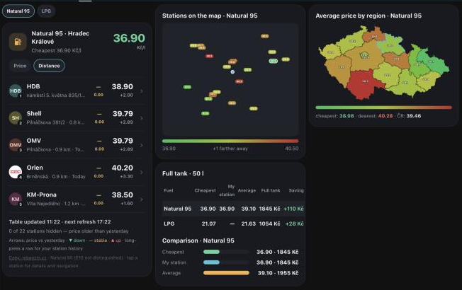
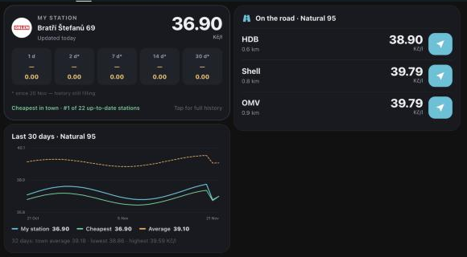

<p align="center"></p>

# ⛽ Ceny paliv – ceny paliv v Home Assistantu

[English](README.md) · **Česky**

Integrace pro HACS, která v Home Assistantu sleduje ceny paliv z [mBenzin.cz](https://www.mbenzin.cz): **nejlevnější stanice ve vašem okolí** pro paliva, která používáte – **Natural 95, naftu, LPG, CNG** a další –, **vaši oblíbenou stanici** s historií cen a trendy, **průměrné ceny ve městě, kraji i celé republice** a hotovou **kartu pro dashboard** s mapami, grafem za 30 dní, detailem stanice a navigací na jedno kliknutí. Sledovat můžete libovolný počet míst (město, bod s okruhem nebo oblast, která se pohybuje s vámi), k tomu automatizace a blueprinty pro změny cen. Všechno se nastavuje v rozhraní Home Assistantu, bez úprav souborů.

<p align="center">
  
  &nbsp;
  
</p>

> **Ceny paliv** je nezávislý projekt. Ceny pocházejí z [mBenzin.cz](https://www.mbenzin.cz); projekt nevytváří, nepodporuje ani neschvaluje mBenzin.cz.

## Co umí

- Vyberete si **město** (nebo **bod na mapě s okruhem**), **jedno či více paliv** (třeba Natural 95 a LPG pro vůz na dvě paliva) a pro každé palivo **oblíbenou stanici**.
- Místo lze také **vystředit na domov v Home Assistantu, na zónu nebo na osobu či zařízení, které se s vámi pohybuje** (oblast ho následuje, bez dalšího požadavku na mBenzin).
- Pro každé palivo **5 nejlevnějších stanic ve městě** (jen z vašeho města, nikoli z celého kraje), **detail stanice** s navigací v **Mapy.com, Google Maps nebo Waze** a **mapu s cenami**.
- **Průměrné ceny** v celé republice, ve vašem kraji a ve vaší oblasti a jak si vaše oblast oproti nim stojí.
- **Události o změně ceny** a tři hotové **blueprinty** pro automatizace: oblíbená stanice zlevní, cena klesne pod váš limit, levná stanice poblíž.
- U oblíbené stanice: aktuální cena, **trendy oproti 1, 2, 7, 14 a 30 dnům**, pořadí ve městě a dlouhodobá statistika (graf za 30 dní).
- Hotová **karta pro dashboard** (`ceny-paliv-card`) přímo v integraci – přidáte ji z nabídky karet, bez kopírování YAML – s volbou jazyka **čeština / angličtina**. Je **přizpůsobitelná**: na širokém dashboardu dva sloupce, v telefonu jeden, kompaktní verze a každou část lze umístit jako samostatnou kartu. Části: oblíbená stanice, seznam (řazení podle **ceny nebo vzdálenosti**; po klepnutí na stanici se otevře její detail), **mapa** (stanice s **logem** se kreslí jako logo), **vlastní graf za 30 dní** (vaše stanice proti nejlevnější a průměru, s **průměrem, minimem a maximem** vašeho města za období), **všechna paliva a cena plné nádrže**, **mapa krajů** a **mapa stanic s barevnými cenami**, zobrazení **„na cestě“** a **místa vedle sebe**. Vzdálenosti se měří **od vašeho domova v Home Assistantu** (nebo od bodu či osoby daného místa). Může převzít vzhled motivu Home Assistantu nebo se změnit na velkou cenu pro nástěnný panel.
- **Odznak** a **funkce dlaždice** s cenou paliva.
- Volitelná **loga čerpacích stanic** (Orlen, MOL, Shell, Tesco…): zaškrtnete řetězce při nastavení a stáhnou se za vás. Řetězce bez loga dostanou barevný odznak s iniciálami.
- Zastaralé ceny se skrývají: u benzínu a nafty cena starší než včerejšek, u CNG starší než 3 dny, u LPG a AdBlue starší než 7 dní. Malé stanice aktualizují zřídka: volba **Zobrazit i starší ceny** (až 3 nebo 7 dní) je ponechá v seznamu s uvedeným datem ceny.

## 1. Získání přístupového klíče (zdarma)

mBenzin před automatickým stahováním dat chrání ověřením prohlížeče, ale uživatelům Home Assistantu **zdarma vystavuje osobní přístupový klíč**.

1. Napište na **reklama@mbenzin.cz**.
2. Uveďte, že ceny budete používat v Home Assistantu, **pro které město nebo stanice** a **jak často** je budete načítat (stačí napsat např. „4× denně“).
3. Klíč vám přijde e-mailem a funguje okamžitě. (Mně odpověděli rychle.)

Co je dobré vědět:

- Klíč je **osobní** – nikomu ho nesdílejte a nikam ho nezveřejňujte. **Každý si žádá vlastní.**
- Limit je **20 stránek za hodinu** na jeden klíč. Tato integrace volá web pouze 4× denně pro každé palivo.
- Integrace používá data cenové mapy mBenzin, nikoli oficiálně zdokumentované API. Buďte k serveru ohleduplní a respektujte podmínky mBenzin.

## 2. Instalace přes HACS

Jedním kliknutím: [](https://my.home-assistant.io/redirect/hacs_repository/?owner=donthedandy&repository=ha-ceny-paliv&category=integration) otevře repozitář v HACS vašeho Home Assistantu (poprvé se [My Home Assistant](https://my.home-assistant.io) zeptá na adresu vaší instance). Pak ho stáhněte a **restartujte** Home Assistant.

Nebo ručně:

1. V HACS otevřete menu **⋮ → Vlastní repozitáře** a přidejte `https://github.com/donthedandy/ha-ceny-paliv` s kategorií **Integrace** (Integration).
2. Vyhledejte **Ceny paliv**, stáhněte ho a **restartujte** Home Assistant.
3. Otevřete **Nastavení → Zařízení a služby → Přidat integraci → Ceny paliv** (nebo klikněte na [](https://my.home-assistant.io/redirect/config_flow_start/?domain=ceny_paliv)) a postupně zadejte:
   1. **přístupový klíč**,
   2. **druh místa**: *město ze seznamu*, nebo *kolem bodu* (značka na mapě a okruh, výchozí 10 km se středem v poloze vašeho Home Assistantu),
   3. město (nebo přesunout značku a nastavit okruh),
   4. **paliva** (jedno nebo více) a **jazyk** textů v dashboardu,
   5. pro každé palivo **oblíbenou stanici** ze stanic místa (nebo „—“, pokud žádnou nechcete),
   6. volitelně zaškrtnout **loga** řetězců (řetězce z vašeho místa jsou předvybrané; viz [Loga čerpacích stanic](#4-loga-čerpacích-stanic-volitelné)).

Místo, paliva, jazyk, oblíbené stanice i loga můžete později změnit tlačítkem **Konfigurovat** u integrace.

> Texty samotného nastavení se řídí jazykem Home Assistantu (čeština i angličtina jsou k dispozici). Volba jazyka v kroku „Paliva a jazyk“ určuje jen popisky v kartě pro dashboard.

## Senzory

Pro každé palivo `<palivo>` (`n95`, `benzinplus`, `diesel`, `dieselplus`, `lpg`, `cng`, `adblue`):

| Entita | Co obsahuje |
|---|---|
| `sensor.ceny_paliv_<palivo>_top5` | cena nejlevnější stanice; v atributech je všech 5 stanic (název, adresa, cena, souřadnice, odkaz na Google Maps, trendy…), `map_stations` (všechny aktuální stanice místa, nejvýše 80, pro kartu), `centre` (středu bodu nebo osoby), `averages` a texty ve zvoleném jazyce. Má dlouhodobé statistiky (nejnižší cena v čase) |
| `sensor.ceny_paliv_<palivo>_home` | cena u vaší oblíbené stanice (jen pokud jste nějakou vybrali), trendy, pořadí, statistika |
| `sensor.ceny_paliv_<palivo>_1` … `_5` | 5 nejlevnějších stanic se zeměpisnou šířkou a délkou pro kartu mapy |
| `sensor.ceny_paliv_<palivo>_national_average` | průměrná cena aktuálních stanic v České republice; v atributech 14 krajů |
| `sensor.ceny_paliv_<palivo>_region_average` | průměrná cena v kraji vašeho místa; nedostupný, když střed místa leží mimo Českou republiku |
| `sensor.ceny_paliv_<palivo>_area_average` | průměrná cena stanic vašeho místa, s `vs_national` a `vs_region` (Kč, pod nulou = levnější) |
| `event.ceny_paliv_<palivo>_price_change` | vyvolá `favourite_cheaper`, `favourite_dearer` a `cheapest_cheaper` (se stanicí, cenou, předchozí cenou, změnou, vzdáleností a odkazem na mapu) |

Tři senzory průměrů počítají jen aktuální stanice (stejný věkový limit jako seznam, včetně **Zobrazit i starší ceny**) a uchovávají dlouhodobé statistiky. Kraj stanice se určí z jejích souřadnic a z hranic krajů dodaných s integrací (ČÚZK, otevřená data CC BY 4.0, zjednodušená: stanice do asi 200 m od hranice kraje se může započítat sousednímu kraji). Vše se počítá ze stejného stažení jako zbytek: bez dalšího požadavku na mBenzin.

Cenová historie oblíbené stanice se zapisuje také do **dlouhodobých statistik** Home Assistantu, podle samotné stanice (`ceny_paliv:<palivo>_<stanice>`), takže historie pokračuje, když stanici vyberete znovu, v jiném místě nebo po odebrání a opětovném přidání integrace.

Senzory se jmenují podle stanice, kterou právě ukazují (např. `1 · Orlen – Bratří Štefanů 69`); identifikátory entit se nemění. Ceny se obnovují každých 6 hodin. Pokud se aktualizace nepovede (třeba kvůli chybě 429), zůstanou zachována poslední data a atribut `fetch_error` uvede důvod.

## Další místa (volitelné)

Na stránce integrace přidá tlačítko **Přidat místo** další město nebo bod s vlastními palivy a oblíbenými stanicemi: třeba domovské město a město, kam často jezdíte. Místa sdílejí klíč a jazyk. Každé místo má vlastní senzory a vlastní kartu; místo odeberete z jeho nabídky ⋮.

<p align="center"></p>

1. Klepněte na **Přidat místo** a vyberte **druh místa**: město ze seznamu, nebo bod na mapě s poloměrem.
2. U bodu přesuňte značku (nebo zadejte souřadnice), nastavte poloměr v metrech a případně místu dejte název. Zde: Plzeň, 10 km.
3. Vyberte paliva a oblíbené stanice, stejně jako u prvního místa.

<p align="center">
  
  &nbsp;
  
</p>

*Snímky obrazovky jsou z anglického rozhraní Home Assistantu; texty se řídí jazykem vašeho HA.*

- **Jaký druh místa?** *Město* sleduje stanice, které mBenzin řadí pod název města. mBenzin některá města dělí na čtvrtě (Plzeň má `Plzen`, `Plzen---Koterov`, …) a několik stanic řadí pod špatné město. Pokud je seznam města neúplný, použijte *Kolem bodu*: zahrnou se všechny stanice uvnitř kruhu bez ohledu na název města.
- **Kde je bod?** Bod lze zvolit **na mapě** (nebo zadat souřadnicemi), být vaším **domovem v Home Assistantu**, **zónou**, nebo **osobou či zařízením** (například aplikací Home Assistant v telefonu). Sledování osoby nebo zařízení přesune oblast, jakmile je asi 1 km od posledního středu, z již stažených cen: bez dalšího požadavku na mBenzin. Když je poloha neznámá, oblast zůstane doma; když osoba nebo zóna přestane existovat, upozorní vás **Opravy**.
- **Už máte nainstalováno?** Samo se nic nezmění: vaše současné místo si ponechá senzory, názvy i historii cen. Chcete-li ho sledovat jako bod, otevřete **Konfigurovat** a zvolte *Kolem bodu*: senzory zůstanou se stejnými identifikátory a historie se zachová, jen znovu vyberete oblíbenou stanici.
- **Více záznamů?** Dříve se integrace přidávala jednou pro každé město. Pokud máte stále více záznamů Ceny paliv, **Přidat místo** se nejdřív zeptá, ke kterému záznamu nové místo patří (tuto otázku klade Home Assistant sám): vyberte ten, který chcete mít jako hlavní. Každý záznam funguje dál jako dříve.
- Senzory prvního místa mají dál identifikátory `sensor.ceny_paliv_<palivo>_…`; u dalších míst je to `sensor.ceny_paliv_<místo>_<palivo>_…` a jejich názvy končí názvem místa.

## Když se něco pokazí

- **mBenzin odpoví „příliš mnoho požadavků“ (HTTP 429):** integrace ponechá poslední ceny, problém uvede v atributu `fetch_error` a **neposílá žádné požadavky**, dokud neuplyne doba, kterou mBenzin požaduje (`Retry-After`, nejvýše 24 hodin; bez ní téměř jeden interval obnovení). Server tedy nezahlcuje.
- **mBenzin odmítne váš klíč:** po jasném odmítnutí (nebo po dvou nečitelných odpovědích za sebou) zobrazí Home Assistant u integrace **Znovu ověřit**: zadáte nový klíč a vše pokračuje, nic nemusíte mazat.
- **24 hodin bez nových cen:** senzory se stanou **nedostupnými** a upozornění v **Opravách** vysvětlí, která paliva, od kdy a kde hledat. Samy se vrátí. Kratší výpadky ponechají poslední ceny.
- **Obnovit hned:** akce `ceny_paliv.refresh` načte ceny okamžitě (volitelně jen pro jednu položku: `config_entry_id`). Data stažená před méně než 30 minutami se znovu nestahují, takže mBenzin nezahltíte.
- **Diagnostika:** *Stáhnout diagnostiku* u integrace poskytne nastavení a stav posledního obnovení, bez vašeho klíče a bez míst či oblíbených stanic, které prozradí, kde bydlíte.
- Každé místo má vlastní **zařízení** (senzory jsou pod ním seskupeny); odebrání paliva odebere jeho senzory a odebraná oblíbená stanice zůstane jako vypnutý diagnostický senzor, aby se neztratila historie. Poškozené záznamy v datech mBenzinu se přeskočí a obnovení nezastaví.

## Automatizace: události a blueprinty

Každé místo a palivo má entitu události `event.ceny_paliv_<palivo>_price_change`. Vyvolá se, když oblíbená stanice zlevní nebo zdraží (`favourite_cheaper`, `favourite_dearer`) a když klesne nejnižší cena místa (`cheapest_cheaper`). První ceny po restartu jsou jen výchozí stav: restart sám změnu nikdy nenahlásí. Používají ji tři blueprinty (importují se jedním kliknutím, pak z nich vytvoříte automatizaci):

| Blueprint | Co dělá | |
|---|---|---|
| **Změna ceny oblíbené stanice** | upozorní, když vaše stanice zlevní (nebo zdraží), s minimální změnou | [](https://my.home-assistant.io/redirect/blueprint_import/?blueprint_url=https%3A%2F%2Fgithub.com%2Fdonthedandy%2Fha-ceny-paliv%2Fblob%2Fmain%2Fblueprints%2Fautomation%2Fceny_paliv%2Ffavourite_price_change.yaml) |
| **Cena pod mým limitem** | upozorní, když nejnižší cena paliva klesne pod váš limit | [](https://my.home-assistant.io/redirect/blueprint_import/?blueprint_url=https%3A%2F%2Fgithub.com%2Fdonthedandy%2Fha-ceny-paliv%2Fblob%2Fmain%2Fblueprints%2Fautomation%2Fceny_paliv%2Fprice_below_limit.yaml) |
| **Levná stanice poblíž** | pro místo, které sleduje osobu nebo zařízení: nová nejnižší cena v zadané vzdálenosti | [](https://my.home-assistant.io/redirect/blueprint_import/?blueprint_url=https%3A%2F%2Fgithub.com%2Fdonthedandy%2Fha-ceny-paliv%2Fblob%2Fmain%2Fblueprints%2Fautomation%2Fceny_paliv%2Fcheap_station_nearby.yaml) |

Texty upozornění jsou anglicky nebo česky a **akci** si zvolíte sami (oznámení v telefonu, hlasová zpráva…); k dispozici jsou `{{ title }}`, `{{ message }}`, `{{ station }}`, `{{ price }}`, `{{ unit }}` a `{{ maps }}`.

## 3. Karta pro dashboard (je součástí, nic dalšího se neinstaluje)

Integrace obsahuje vlastní kartu **`ceny-paliv-card`**. Po instalaci (a restartu) stačí:

1. Otevřít dashboard → **Upravit** → **Přidat kartu** → vyhledat **Ceny paliv**.
2. Vybrat **palivo** (editor nabídne paliva, která jste nastavili). Hotovo.

<p align="center"></p>

Nebo v YAML:

```yaml
type: custom:ceny-paliv-card
fuel: n95            # n95 | benzinplus | diesel | dieselplus | lpg | cng | adblue
```

Pro každé palivo jedna karta: pro vůz na dvě paliva přidejte druhou kartu s `fuel: lpg` nebo zapněte `fuel_switch` a palivo přepínejte tlačítky. Ve výchozím stavu má karta čtyři části: oblíbenou stanici (cena, trendy, pořadí), nejlevnější stanice (klepnutím na stanici se otevře její detail: podrobnosti, kolik ušetříte a navigace), mapu a graf za 30 dní. Další části si vyžádáte volbou `show` (viz níže). Všechny volby jsou i ve vizuálním editoru karty, který ukládá jen to, co jste změnili.

| Volba | Výchozí | |
|---|---|---|
| `fuel` | – | povinné |
| `place` | první místo | název místa, sledujete-li jich víc (vizuální editor nabídne seznam) |
| `show` | `[home, list, map, graph]` | které části zobrazit: `home` (oblíbená stanice), `list` (nejlevnější stanice), `map` (mapa Home Assistantu), `graph` (30 dní: vaše stanice, nejlevnější, průměr), `prices` (mapa stanic s barevnými cenami), `regions` (mapa krajů), `tank` (všechna paliva a plná nádrž), `road` (nejbližší stanice s tlačítkem navigace), `places` (více míst vedle sebe) |
| `layout` | `auto` | `auto`: dva sloupce (stanice a seznam vlevo, mapa a graf vpravo), je-li karta široká, a jeden sloupec, je-li úzká, třeba v telefonu; `columns`: vždy dva; `stack`: vždy jeden |
| `stations` | `5` | kolik stanic v seznamu (1–10; mapa Home Assistantu ukazuje nejvýše 5) |
| `sort` | `price` | `price` (cena) nebo `distance` (vzdálenost). Vzdálenosti se měří od vašeho domova v Home Assistantu, pokud je místo město poblíž, jinak od bodu nebo osoby daného místa, jinak od středu města. Tlačítka nad seznamem umožňují přepínat |
| `navigation` | `google` | aplikace tlačítka navigace: `google`, `mapy` (Mapy.com) nebo `waze`. Detail stanice nabízí všechny tři |
| `fuel_switch` | `false` | tlačítka pro přepnutí paliva bez úpravy karty |
| `tank_size` | `40` | litry plné nádrže (část `tank`) |
| `places` | – | názvy míst zobrazených vedle sebe (část `places`) |
| `look` | `dark` | `dark` (vlastní vzhled karty) nebo `ha` (barvy a zaoblení motivu Home Assistantu) |
| `big` | `false` | nástěnný panel: jedna velká cena (oblíbená stanice, jinak nejlevnější) |
| `compact` | `false` | úsporná verze: jeden řádek na stanici, trendy na jednom řádku, bez legendy |
| `show_footer` | `true` (`false` při `compact`) | časy aktualizace a legenda pod seznamem |
| `map_height` | automaticky | výška mapy v pixelech |
| `logo_path` | – | jen pokud chcete vlastní PNG místo balíčku log (viz níže) |

Texty karty odpovídají jazyku zvolenému při nastavení. Pokud se karta po aktualizaci nezobrazí, obnovte stránku v prohlížeči (Ctrl+F5).

### Nové části

<p align="center"></p>
<p align="center"></p>


- **`graph`** kreslí posledních 30 dní oblíbené stanice, nejlevnější stanice a průměru vaší oblasti z dlouhodobých statistik Home Assistantu (plní se s ukládáním cen).
- **`prices`** kreslí stanice na jednoduché mapě: každá značka nese cenu a je zbarvená od zelené (levná) po červenou (drahá); vaše stanice má bílý okraj, klepnutím na značku otevřete detail.
- **`regions`** obarví 14 krajů podle průměrné ceny; klepnutím na kraj uvidíte průměr, pořadí a rozdíl oproti republice. Potřebuje průměrné ceny; váš kraj je orámovaný.
- **`tank`** vypíše každé palivo místa s nejnižší cenou, vaší stanicí, průměrem, cenou plné nádrže u nejlevnější stanice a úsporou proti průměru; klepnutím na palivo ho porovnáte níže.
- **`road`** je pro místo, které sleduje osobu nebo bod: tři nejbližší stanice s tlačítkem navigace. Funguje i pro město poblíž vašeho domova v Home Assistantu: vzdálenosti se pak měří od domova.
- **`places`** dá vedle sebe několik míst (`places: [Praha, Brno]`).

**Odznak**: `type: custom:ceny-paliv-badge`, `fuel: n95` (`place:` pro jiné místo, `show: home` pro oblíbenou stanici). **Funkce dlaždice**: přidejte `features: [{type: custom:ceny-paliv-tile-feature}]` ke kartě Dlaždice, jejíž entitou je senzor Ceny paliv (nejnižší cena, průměr, rozdíl a vaše pořadí).

### Části si rozmístěte, kam chcete

Pomocí více karet s volbou `show` umístíte každou část kamkoli na dashboard, i s jinými kartami mezi nimi:

```yaml
type: custom:ceny-paliv-card
fuel: n95
show: [home]          # jen moje stanice
---
type: custom:ceny-paliv-card
fuel: n95
show: [list]
stations: 3
compact: true         # malá dlaždice se 3 nejlevnějšími stanicemi
---
type: custom:ceny-paliv-card
fuel: n95
show: [map, graph]
map_height: 260
```

(Jsou to tři samostatné karty; `---` je tu jen odděluje.) V dashboardu typu *sekce* si karta velikost přizpůsobí obsahu.

Upozornění na změnu ceny na telefonu: viz `examples/price_alert.yaml`.

## 4. Loga čerpacích stanic (volitelné)

Karta u každé stanice ukazuje kulaté logo jejího řetězce. Bez loga nakreslí barevný odznak s iniciálami řetězce (`OR`, `PR`…), takže není třeba nic nastavovat. Logo se objeví i na mapě Home Assistantu v kartě a jako obrázek senzorů stanic všude, kde Home Assistant zobrazuje obrázky entit: senzory `…_1` až `…_5` mají logo stanice, která je právě na daném místě pořadí.

Chcete-li skutečná loga, otevřete **Nastavení → Zařízení a služby → Ceny paliv → Konfigurovat**, přejděte na krok **Loga čerpacích stanic** a zaškrtněte řetězce. Stáhnou se (pár KB každé) z [balíčku log](logos/) v tomto repozitáři do složky `ceny_paliv_logos` v konfiguraci Home Assistantu a karta je najde sama. Odškrtnutím logo odstraníte. Při prvním nastavení jsou předvybrané řetězce z vašeho města. Nestahuje se nic, co nezaškrtnete, a balíček se s integrací neinstaluje.

Balíček je také ke stažení jako **`ceny-paliv-logos.zip`** u každého [vydání](https://github.com/donthedandy/ha-ceny-paliv/releases): pokud to raději uděláte ručně, rozbalte ho do `<config>/ceny_paliv_logos/` (nové soubory se načtou po restartu nebo znovunačtení integrace). Můžete tam dát i vlastní čtvercové PNG pojmenované podle řetězce malými písmeny, bez diakritiky, s pomlčkami místo mezer (`eurobit.png`, `robin-oil.png`): takové soubory se používají a nikdy se nemažou. Chcete-li soubory z jiné složky, nastavte na kartě `logo_path: /local/logos/` (soubory pojmenované podle řetězce, např. `/local/logos/orlen.png`).

Loga jsou ochranné známky svých majitelů a slouží jen k označení stanic; projekt s nimi nijak nesouvisí. Zdroje a postup při žádosti o odstranění jsou v [logos/SOURCES.md](logos/SOURCES.md).

## 5. Bez karty: standardní karty

Každý senzor se jmenuje podle toho, co právě ukazuje (např. `1 · Orlen – Bratří Štefanů 69`), takže stanici zobrazí jakákoli standardní karta, bez šablony. Názvy sledují pořadí a mění se při každé aktualizaci; identifikátory entit se nemění.

Karta **Entity** s 5 nejlevnějšími stanicemi (stav senzoru je cena):

```yaml
type: entities
title: Natural 95
entities:
  - sensor.ceny_paliv_n95_1
  - sensor.ceny_paliv_n95_2
  - sensor.ceny_paliv_n95_3
  - sensor.ceny_paliv_n95_4
  - sensor.ceny_paliv_n95_5
```

Karta **Markdown** s adresou a odkazem na Google Maps:

```yaml
type: markdown
title: Natural 95 – top 5
content: |-
  
  {{ s.rank }}. **{{ s.name }}** – {{ s.street }}: **{{ '%.2f' | format(s.price) }} Kč/l** · [Maps]({{ s.maps }})
  
```

Každá stanice v atributu `stations` senzoru `sensor.ceny_paliv_<palivo>_top5` má: `rank`, `name`, `street`, `address`, `price`, `lat`, `lng`, `updated`, `maps`, `home` a `trends`. Pro oblíbenou stanici použijte senzor `_home` (jeho atributy obsahují `rank`, `vs_cheapest` a `trends`).

## Poznámky

- **E10** mBenzin nerozlišuje: u Natural 95 jde o cenu pro všechny 95oktanové benzíny.
- Entity se jmenují `sensor.ceny_paliv_<palivo>_…` u prvního místa a `sensor.ceny_paliv_<místo>_<palivo>_…` u ostatních. Názvy měst se zobrazují s českým pravopisem (Dobřany), pokud ho mBenzin uvádí.
- Denní záznam cen potřebný pro trendy ukládá Home Assistant a postupně se plní (hvězdička u trendu v kartě označuje trend z kratší historie).

## Plán vývoje

Co se chystá, je vidět veřejně, každá funkce má vlastní issue:

- **[v0.7.0](https://github.com/donthedandy/ha-ceny-paliv/milestone/1)** – chytřejší data: sledování osoby nebo zařízení, další zdroje polohy, průměrné ceny, starší ceny, čistší adresy, události o změně ceny a blueprinty.
- **[v0.8.0](https://github.com/donthedandy/ha-ceny-paliv/milestone/2)** – bohatší karta: detail stanice s navigací, řazení, srovnávací graf, cena plné nádrže, další mapy, odznak a dlaždice (vydáno).
- **v0.8.1** – vzdálenosti od vašeho domova v Home Assistantu, loga řetězců na mapě Home Assistantu, průměr, minimum a maximum města za 30 dní v grafu; „Vyplatí se“ odstraněno (vydáno).

Nápady i hlasy jsou vítány: otevřete issue nebo přidejte 👍 u té, kterou chcete.

## Poděkování

Práce na spolehlivosti ve verzi 0.6 (čekání po HTTP 429, žádost o nový klíč, diagnostika, Opravy, akce obnovení) funkce verze 0.7 (zdroje polohy, průměrné ceny, události o změně ceny a blueprinty) a verze 0.8 (detail stanice, řazení, srovnávací graf, cena nádrže, mapy krajů a cen, odznak a funkce dlaždice, „na cestě“) byly inspirovány [forkem Vituhlose](https://github.com/Vituhlos/ha-ceny-paliv) tohoto projektu, rovněž pod licencí MIT. Hranice krajů (`regions.json`, `script/build_regions.py`) pocházejí také z tohoto forku; samotná data jsou otevřená data ČÚZK (RÚIAN), CC BY 4.0, zjednodušená. Děkuji!

## Licence

MIT – viz [LICENSE](LICENSE).
