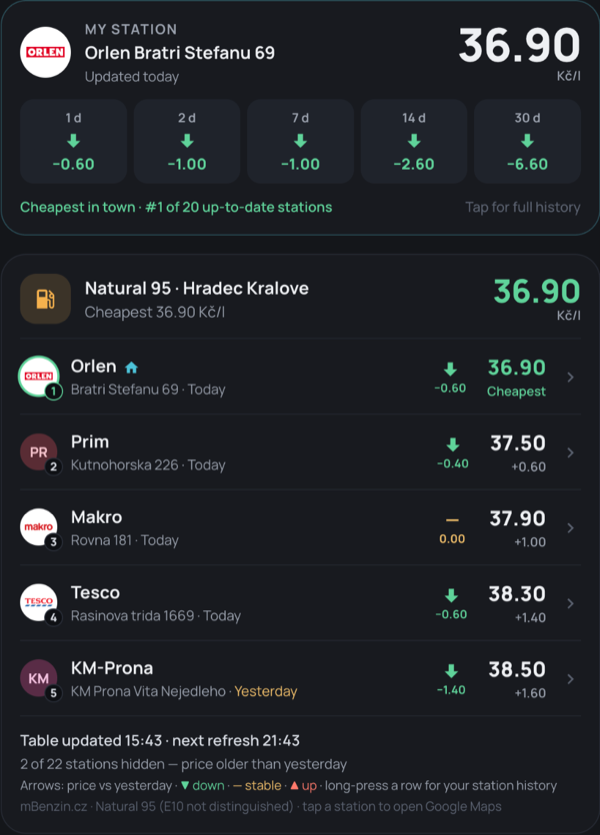
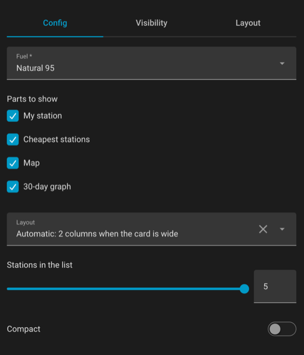

<p align="center"></p>

# ⛽ Ceny paliv – ceny paliv v Home Assistantu

[English](README.md) · **Česky**

Integrace pro HACS, která v Home Assistantu ukazuje ceny paliv z [mBenzin.cz](https://www.mbenzin.cz) pro **vaše město**: **Natural 95, naftu, LPG, CNG** a další. Najdete v ní žebříček nejlevnějších čerpacích stanic, mapu a **vaši oblíbenou stanici** s historií cen a trendy. Všechno se nastavuje v rozhraní Home Assistantu, bez úprav souborů.

<p align="center">
  
  &nbsp;
  
</p>

> **Ceny paliv** je nezávislý projekt. Ceny pocházejí z [mBenzin.cz](https://www.mbenzin.cz); projekt nevytváří, nepodporuje ani neschvaluje mBenzin.cz.

## Co umí

- Vyberete si **město** (nebo **bod na mapě s okruhem**), **jedno či více paliv** (třeba Natural 95 a LPG pro vůz na dvě paliva) a pro každé palivo **oblíbenou stanici**.
- Pro každé palivo **5 nejlevnějších stanic ve městě** (jen z vašeho města, nikoli z celého kraje), odkaz na Google Maps a **mapu s cenami**.
- U oblíbené stanice: aktuální cena, **trendy oproti 1, 2, 7, 14 a 30 dnům**, pořadí ve městě a dlouhodobá statistika (graf za 30 dní).
- Hotová **karta pro dashboard** (`ceny-paliv-card`) přímo v integraci – přidáte ji z nabídky karet, bez kopírování YAML – s volbou jazyka **čeština / angličtina**. Je **přizpůsobitelná**: na širokém dashboardu dva sloupce, v telefonu jeden, kompaktní verze a každou část (oblíbená stanice, seznam, mapa, graf) lze umístit jako samostatnou kartu.
- Volitelná **loga čerpacích stanic** (Orlen, MOL, Shell, Tesco…): zaškrtnete řetězce při nastavení a stáhnou se za vás. Řetězce bez loga dostanou barevný odznak s iniciálami.
- Zastaralé ceny se skrývají: u benzínu a nafty cena starší než včerejšek, u CNG starší než 3 dny, u LPG a AdBlue starší než 7 dní.

## 1. Získání přístupového klíče (zdarma)

mBenzin před automatickým stahováním dat chrání ověřením prohlížeče, ale uživatelům Home Assistantu **zdarma vystavuje osobní přístupový klíč**.

1. Napište na **reklama@mbenzin.cz**.
2. Uveďte, že ceny budete používat v Home Assistantu, **pro které město nebo stanice** a **jak často** je budete načítat (stačí napsat např. „4× denně“).
3. Klíč vám přijde e-mailem a funguje okamžitě. (Mně odpověděli rychle.)

Co je dobré vědět:

- Klíč je **osobní** – nikomu ho nesdílejte a nikam ho nezveřejňujte. **Každý si žádá vlastní.**
- Limit je **20 stránek za hodinu** na jeden klíč. Tato integrace volá web pouze 4× denně pro každé palivo.
- Integrace používá data cenové mapy mBenzin, nikoli oficiálně zdokumentované API. Buďte k serveru ohleduplní a respektujte podmínky mBenzin.

## 2. Instalace přes HACS

1. V HACS otevřete menu **⋮ → Vlastní repozitáře** a přidejte `https://github.com/donthedandy/ha-ceny-paliv` s kategorií **Integrace** (Integration).
2. Vyhledejte **Ceny paliv**, stáhněte ho a **restartujte** Home Assistant.
3. Otevřete **Nastavení → Zařízení a služby → Přidat integraci → Ceny paliv** a postupně zadejte:
   1. **přístupový klíč**,
   2. **druh místa**: *město ze seznamu*, nebo *kolem bodu* (značka na mapě a okruh, výchozí 10 km se středem v poloze vašeho Home Assistantu),
   3. město (nebo přesunout značku a nastavit okruh),
   4. **paliva** (jedno nebo více) a **jazyk** textů v dashboardu,
   5. pro každé palivo **oblíbenou stanici** ze stanic místa (nebo „—“, pokud žádnou nechcete),
   6. volitelně zaškrtnout **loga** řetězců (řetězce z vašeho místa jsou předvybrané; viz [Loga čerpacích stanic](#4-loga-čerpacích-stanic-volitelné)).

Místo, paliva, jazyk, oblíbené stanice i loga můžete později změnit tlačítkem **Konfigurovat** u integrace.

> Texty samotného nastavení se řídí jazykem Home Assistantu (čeština i angličtina jsou k dispozici). Volba jazyka v kroku „Paliva a jazyk“ určuje jen popisky v kartě pro dashboard.

## Senzory

Pro každé palivo `<palivo>` (`n95`, `benzinplus`, `diesel`, `dieselplus`, `lpg`, `cng`, `adblue`):

| Entita | Co obsahuje |
|---|---|
| `sensor.ceny_paliv_<palivo>_top5` | cena nejlevnější stanice; v atributech je všech 5 stanic (název, adresa, cena, souřadnice, odkaz na Google Maps, trendy…) a texty ve zvoleném jazyce |
| `sensor.ceny_paliv_<palivo>_home` | cena u vaší oblíbené stanice (jen pokud jste nějakou vybrali), trendy, pořadí, statistika |
| `sensor.ceny_paliv_<palivo>_1` … `_5` | 5 nejlevnějších stanic se zeměpisnou šířkou a délkou pro kartu mapy |

Senzory se jmenují podle stanice, kterou právě ukazují (např. `1 · Orlen – Bratri Stefanu 69`); identifikátory entit se nemění. Ceny se obnovují každých 6 hodin. Pokud se aktualizace nepovede (třeba kvůli chybě 429), zůstanou zachována poslední data a atribut `fetch_error` uvede důvod.

## Další místa (volitelné)

Na stránce integrace přidá tlačítko **Přidat místo** další město nebo bod s vlastními palivy a oblíbenými stanicemi: třeba domovské město a město, kam často jezdíte. Místa sdílejí klíč a jazyk. Každé místo má vlastní senzory a vlastní kartu; místo odeberete z jeho nabídky ⋮.

<p align="center"></p>

1. Klepněte na **Přidat místo** a vyberte **druh místa**: město ze seznamu, nebo bod na mapě s poloměrem.
2. U bodu přesuňte značku (nebo zadejte souřadnice), nastavte poloměr v metrech a případně místu dejte název. Zde: Plzeň, 10 km.
3. Vyberte paliva a oblíbené stanice, stejně jako u prvního místa.

<p align="center">
  
  &nbsp;
  
</p>

*Snímky obrazovky jsou z anglického rozhraní Home Assistantu; texty se řídí jazykem vašeho HA.*

- **Jaký druh místa?** *Město* sleduje stanice, které mBenzin řadí pod název města. mBenzin některá města dělí na čtvrtě (Plzeň má `Plzen`, `Plzen---Koterov`, …) a několik stanic řadí pod špatné město. Pokud je seznam města neúplný, použijte *Kolem bodu*: zahrnou se všechny stanice uvnitř kruhu bez ohledu na název města.
- **Už máte nainstalováno?** Samo se nic nezmění: vaše současné místo si ponechá senzory, názvy i historii cen. Chcete-li ho sledovat jako bod, otevřete **Konfigurovat** a zvolte *Kolem bodu*: senzory zůstanou se stejnými identifikátory a historie se zachová, jen znovu vyberete oblíbenou stanici.
- Senzory prvního místa mají dál identifikátory `sensor.ceny_paliv_<palivo>_…`; u dalších míst je to `sensor.ceny_paliv_<místo>_<palivo>_…` a jejich názvy končí názvem místa.

## 3. Karta pro dashboard (je součástí, nic dalšího se neinstaluje)

Integrace obsahuje vlastní kartu **`ceny-paliv-card`**. Po instalaci (a restartu) stačí:

1. Otevřít dashboard → **Upravit** → **Přidat kartu** → vyhledat **Ceny paliv**.
2. Vybrat **palivo** (editor nabídne paliva, která jste nastavili). Hotovo.

<p align="center"></p>

Nebo v YAML:

```yaml
type: custom:ceny-paliv-card
fuel: n95            # n95 | benzinplus | diesel | dieselplus | lpg | cng | adblue
```

Pro každé palivo jedna karta: pro vůz na dvě paliva přidejte druhou kartu s `fuel: lpg`. Karta má čtyři části: vaši oblíbenou stanici (cena, trendy, pořadí), 5 nejlevnějších stanic (klepnutím se otevře Google Maps), mapu a graf za 30 dní. Všechny volby níže jsou i ve vizuálním editoru karty.

| Volba | Výchozí | |
|---|---|---|
| `fuel` | – | povinné |
| `place` | první místo | název místa, sledujete-li jich víc (vizuální editor nabídne seznam) |
| `show` | `[home, list, map, graph]` | které části zobrazit: `home` (oblíbená stanice), `list` (nejlevnější stanice), `map`, `graph` (30 dní) |
| `layout` | `auto` | `auto`: dva sloupce (stanice a seznam vlevo, mapa a graf vpravo), je-li karta široká, a jeden sloupec, je-li úzká, třeba v telefonu; `columns`: vždy dva; `stack`: vždy jeden |
| `stations` | `5` | kolik stanic v seznamu (1–5, i na mapě) |
| `compact` | `false` | úsporná verze: jeden řádek na stanici, trendy na jednom řádku, bez legendy |
| `show_footer` | `true` (`false` při `compact`) | časy aktualizace a legenda pod seznamem |
| `map_height` | automaticky | výška mapy v pixelech |
| `logo_path` | – | jen pokud chcete vlastní PNG místo balíčku log (viz níže) |

Texty karty odpovídají jazyku zvolenému při nastavení. Pokud se karta po aktualizaci nezobrazí, obnovte stránku v prohlížeči (Ctrl+F5).

### Části si rozmístěte, kam chcete

Pomocí více karet s volbou `show` umístíte každou část kamkoli na dashboard, i s jinými kartami mezi nimi:

```yaml
type: custom:ceny-paliv-card
fuel: n95
show: [home]          # jen moje stanice
---
type: custom:ceny-paliv-card
fuel: n95
show: [list]
stations: 3
compact: true         # malá dlaždice se 3 nejlevnějšími stanicemi
---
type: custom:ceny-paliv-card
fuel: n95
show: [map, graph]
map_height: 260
```

(Jsou to tři samostatné karty; `---` je tu jen odděluje.) V dashboardu typu *sekce* si karta velikost přizpůsobí obsahu.

Upozornění na změnu ceny na telefonu: viz `examples/price_alert.yaml`.

## 4. Loga čerpacích stanic (volitelné)

Karta u každé stanice ukazuje kulaté logo jejího řetězce. Bez loga nakreslí barevný odznak s iniciálami řetězce (`OR`, `PR`…), takže není třeba nic nastavovat.

Chcete-li skutečná loga, otevřete **Nastavení → Zařízení a služby → Ceny paliv → Konfigurovat**, přejděte na krok **Loga čerpacích stanic** a zaškrtněte řetězce. Stáhnou se (pár KB každé) z [balíčku log](logos/) v tomto repozitáři do složky `ceny_paliv_logos` v konfiguraci Home Assistantu a karta je najde sama. Odškrtnutím logo odstraníte. Při prvním nastavení jsou předvybrané řetězce z vašeho města. Nestahuje se nic, co nezaškrtnete, a balíček se s integrací neinstaluje.

Balíček je také ke stažení jako **`ceny-paliv-logos.zip`** u každého [vydání](https://github.com/donthedandy/ha-ceny-paliv/releases): pokud to raději uděláte ručně, rozbalte ho do `<config>/ceny_paliv_logos/` (nové soubory se načtou po restartu nebo znovunačtení integrace). Můžete tam dát i vlastní čtvercové PNG pojmenované podle řetězce malými písmeny, bez diakritiky, s pomlčkami místo mezer (`eurobit.png`, `robin-oil.png`): takové soubory se používají a nikdy se nemažou. Chcete-li soubory z jiné složky, nastavte na kartě `logo_path: /local/logos/` (soubory pojmenované podle řetězce, např. `/local/logos/orlen.png`).

Loga jsou ochranné známky svých majitelů a slouží jen k označení stanic; projekt s nimi nijak nesouvisí. Zdroje a postup při žádosti o odstranění jsou v [logos/SOURCES.md](logos/SOURCES.md).

## 5. Bez karty: standardní karty

Každý senzor se jmenuje podle toho, co právě ukazuje (např. `1 · Orlen – Bratri Stefanu 69`), takže stanici zobrazí jakákoli standardní karta, bez šablony. Názvy sledují pořadí a mění se při každé aktualizaci; identifikátory entit se nemění.

Karta **Entity** s 5 nejlevnějšími stanicemi (stav senzoru je cena):

```yaml
type: entities
title: Natural 95
entities:
  - sensor.ceny_paliv_n95_1
  - sensor.ceny_paliv_n95_2
  - sensor.ceny_paliv_n95_3
  - sensor.ceny_paliv_n95_4
  - sensor.ceny_paliv_n95_5
```

Karta **Markdown** s adresou a odkazem na Google Maps:

```yaml
type: markdown
title: Natural 95 – top 5
content: |-
  
  {{ s.rank }}. **{{ s.name }}** – {{ s.street }}: **{{ '%.2f' | format(s.price) }} Kč/l** · [Maps]({{ s.maps }})
  
```

Každá stanice v atributu `stations` senzoru `sensor.ceny_paliv_<palivo>_top5` má: `rank`, `name`, `street`, `address`, `price`, `lat`, `lng`, `updated`, `maps`, `home` a `trends`. Pro oblíbenou stanici použijte senzor `_home` (jeho atributy obsahují `rank`, `vs_cheapest` a `trends`).

## Poznámky

- **E10** mBenzin nerozlišuje: u Natural 95 jde o cenu pro všechny 95oktanové benzíny.
- Entity se jmenují `sensor.ceny_paliv_<palivo>_…` u prvního místa a `sensor.ceny_paliv_<místo>_<palivo>_…` u ostatních. Názvy měst se zobrazují s českým pravopisem (Dobřany), pokud ho mBenzin uvádí.
- Denní záznam cen potřebný pro trendy ukládá Home Assistant a postupně se plní (hvězdička u trendu v kartě označuje trend z kratší historie).

## Licence

MIT – viz [LICENSE](LICENSE).
