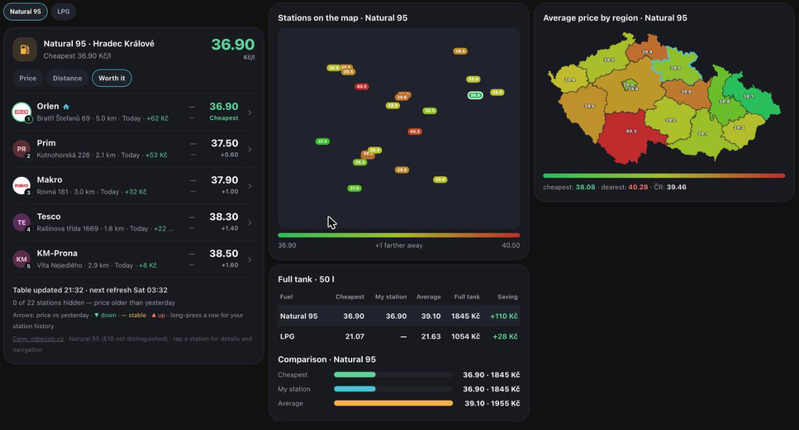
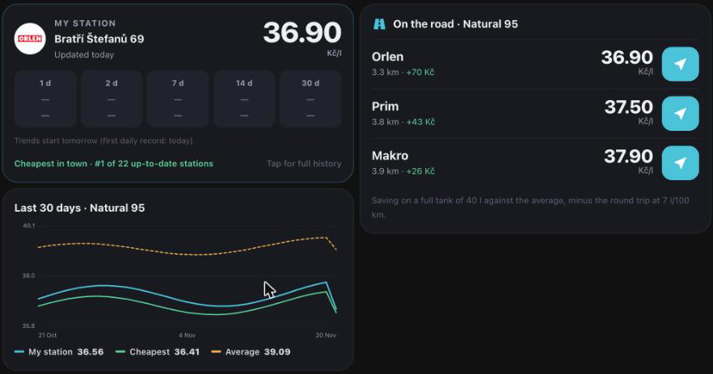

<p align="center"></p>

# ⛽ Ceny paliv – Czech fuel prices for Home Assistant

**English** · [Česky](README.cs.md)

A HACS integration that shows the cheapest stations of **your city** for the fuel(s) you use — **Natural 95, Diesel, LPG, CNG** and more — plus **your favourite station** with price history and trends. Everything is configured from the Home Assistant UI.

<p align="center">
  
  &nbsp;
  
</p>

> **Ceny paliv** (Czech for “fuel prices”) is an independent project. The prices come from [mBenzin.cz](https://www.mbenzin.cz); this project is not made, endorsed or supported by mBenzin.cz.

## Features

- Pick your **city** (or **a point on the map with a radius**), one or **several fuels** (e.g. Natural 95 + LPG for a dual-fuel car) and a **favourite station per fuel**
- Follow **as many places as you like** (home, the city you drive to, a holiday area…): one key, an **Add place** button, one card per place
- A place can also be **centred on your Home Assistant home, on a zone, or on a person or device that moves with you** (the area follows them, with no extra request to mBenzin)
- Per fuel: the **top 5 cheapest** stations in the city (only that city, not the region), a **station sheet** with navigation in **Mapy.com, Google Maps or Waze**, and a **map**
- **Average prices** of the country, of your region (kraj) and of your area, and how your area stands against them
- **Price-change events** and three ready-made **automation blueprints**: your favourite station gets cheaper, a price drops under your limit, a cheap station near you
- Favourite station: price, **trends vs 1/2/7/14/30 days ago**, rank in town, long-term statistics (the 30-day graph)
- A ready-made **dashboard card** (`ceny-paliv-card`) shipped with the integration — add it from the card picker, no YAML to copy — in **English or Czech** (your choice during setup). It is **flexible**: two columns on a wide dashboard, one on a phone, a compact version, and every part can be placed as its own card. Parts: favourite station, list (sort by **price, distance or “worth it”**), map, **own 30-day graph** (your station vs the cheapest vs the average), **all fuels and the cost of a full tank**, a **map of the regions** and a **map of the stations with coloured prices**, an **“on the road”** view and **places side by side**. It can take the look of your Home Assistant theme, or become a big price for a wall panel
- A **badge** and a **tile card feature** with a fuel price
- Optional **station logos** (Orlen, MOL, Shell, Tesco…): tick the chains you want in the setup and they are downloaded for you. Chains without a logo get a colour badge with their initials
- Stale prices are hidden (older than yesterday for petrol/diesel, 3 days for CNG, 7 days for LPG/AdBlue). Small stations update rarely: the setting **Show older prices too** (up to 3 or 7 days) keeps them in the list with the price date shown

## 1. Get your access key (free)

mBenzin blocks plain scraping with a browser check, but they give a **personal access key** to Home Assistant users. E-mail **reklama@mbenzin.cz** and tell them what the prices are for, which city/stations, and how often you load them. (For me the answer came quickly and the key worked immediately.)

- The key is **personal — never share it or publish it**. Everyone requests their own.
- Limit: **20 pages per hour** per key. This integration makes 4 calls a day per fuel.
- It uses mBenzin's price-map data, which is not a documented public API: be gentle and respect their conditions.

## 2. Install with HACS

1. HACS → ⋮ → **Custom repositories** → add `https://github.com/donthedandy/ha-ceny-paliv`, category **Integration**.
2. Search for **Ceny paliv**, download it, **restart** Home Assistant.
3. Settings → Devices & services → **Add integration** → **Ceny paliv**, then:
   1. paste your **access key**
   2. choose the **kind of place**: *a town from the list*, or *around a point* (a marker on the map and a radius, 10 km by default, centred on your Home Assistant location)
   3. choose the town (or move the marker and set the radius)
   4. choose your **fuel(s)** and the **language** of the dashboard texts (English / Čeština)
   5. for each fuel, choose your **favourite station** from the stations of the place (or "—" for none)
   6. optionally tick the **logos** of the chains to show (the chains of your place are preselected; see [Station logos](#4-station-logos-optional))

You can change the place, the fuels, the language, the favourite stations and the logos later: the integration's **Configure** button.

> The setup screens follow Home Assistant's own language (English and Czech are provided). The language chosen in step 3 only sets the labels of the dashboard card.

## Entities

For each fuel `<fuel>` (`n95`, `benzinplus`, `diesel`, `dieselplus`, `lpg`, `cng`, `adblue`):

| Entity | What |
|---|---|
| `sensor.ceny_paliv_<fuel>_top5` | price of the cheapest station; attributes: the 5 stations (name, address, price, coordinates, Google Maps link, trends…), `map_stations` (all the up-to-date stations of the place, up to 80, for the card), `centre` (of a point or person) and `averages`. Has long-term statistics (the cheapest price over time) |
| `sensor.ceny_paliv_<fuel>_home` | price at your favourite station (only if you chose one); trends, rank, statistics |
| `sensor.ceny_paliv_<fuel>_1` … `_5` | the 5 cheapest stations, with latitude/longitude for the map card |
| `sensor.ceny_paliv_<fuel>_national_average` | average price of the up-to-date stations in the Czech Republic; the 14 regions in the attributes |
| `sensor.ceny_paliv_<fuel>_region_average` | average price in the region (kraj) of your place; unavailable when the centre of the place is outside the Czech Republic |
| `sensor.ceny_paliv_<fuel>_area_average` | average price of the stations of your place, with `vs_national` and `vs_region` (Kč, below zero = cheaper) |
| `event.ceny_paliv_<fuel>_price_change` | fires `favourite_cheaper`, `favourite_dearer` and `cheapest_cheaper` (with the station, the price, the previous price, the change, the distance and a map link) |

The three average sensors count only the up-to-date stations (the same age limit as the list, including **Show older prices too**) and keep long-term statistics. A station's region comes from its coordinates and the region boundaries shipped with the integration (ČÚZK, open data CC BY 4.0, simplified: a station within about 200 m of a regional border may count for the neighbouring region). Everything is computed from the same download as the rest: no extra request to mBenzin.

Your favourite station's price history also goes to Home Assistant's **long-term statistics**, keyed by the station itself (`ceny_paliv:<fuel>_<station>`), so the history goes on when you choose the station again, in another place, or after removing and adding the integration.

The sensors are named after the station they currently show (for example `1 · Orlen – Bratří Štefanů 69`); the entity ids never change. Prices refresh every 6 hours. If a refresh fails (for example HTTP 429) the last data is kept and the attribute `fetch_error` says why.

## More places (optional)

On the integration page, the **Add place** button adds another town or point with its own fuels and favourite stations: for example your home town and the city you often drive to. The places share the key and the language. Each place has its own sensors and its own card; remove a place from its ⋮ menu.

<p align="center"></p>

1. Click **Add place** and choose the **kind of place**: a town from the list, or a point on the map with a radius.
2. For a point, move the marker (or type the coordinates), set the radius in metres and, if you like, give the place a name. Here: Plzeň, 10 km.
3. Choose the fuels and your favourite stations, as for the first place.

<p align="center">
  
  &nbsp;
  
</p>

- **Which kind of place?** A *town* follows the stations that mBenzin files under that town name. Some towns are split by mBenzin into districts (Plzeň has `Plzen`, `Plzen---Koterov`, …), and a few stations are filed under the wrong town. If the list of a town looks incomplete, use *Around a point* instead: every station inside the circle is included, whatever the town name.
- **Where is the point?** A point can be picked **on the map** (or typed as coordinates), be your **Home Assistant home**, a **zone**, or a **person or device** (for example the Home Assistant app on your phone). Following a person or device moves the area once they are about 1 km away from the last centre, from the prices already downloaded: no extra request to mBenzin. If their location is unknown the area waits at home; if the person or zone does not exist any more a **Repairs** notice says so.
- **Already installed?** Nothing changes by itself: your current place keeps its sensors, its names and its price history. To follow your current place as a point, open **Configure** and choose *Around a point*: the sensors keep their ids and the history stays, you only pick your favourite station again.
- Sensors of the first place keep the ids `sensor.ceny_paliv_<fuel>_…`; the ones of the other places are `sensor.ceny_paliv_<place>_<fuel>_…` and their names end with the name of the place.

## When something goes wrong

- **mBenzin answers "too many requests" (HTTP 429):** the integration keeps the last prices, flags the problem in the attribute `fetch_error` and sends **no request at all** until the time mBenzin asked for (`Retry-After`, at most 24 hours; without it, almost one refresh interval). It does not hammer the server.
- **mBenzin refuses your key:** after a clear refusal (or an unreadable answer twice in a row) Home Assistant shows **Reauthenticate** on the integration: enter the new key and everything continues, no need to delete anything.
- **No fresh prices for 24 hours:** the sensors become **unavailable** and a **Repairs** notice explains which fuels, since when and where to look. They come back by themselves. Shorter outages keep the last prices.
- **Refresh now:** the action `ceny_paliv.refresh` loads the prices immediately (optionally for one entry: `config_entry_id`). Data downloaded less than 30 minutes ago is not downloaded again, so it cannot flood mBenzin.
- **Diagnostics:** *Download diagnostics* on the integration gives the settings and the state of the last refresh, without your key and without the places or favourite stations that point to where you live.
- Each place has its own **device** (the sensors are grouped under it); removing a fuel removes its sensors, and a favourite you remove is kept as a disabled diagnostic sensor so its history is not lost. Malformed entries in mBenzin's data are skipped instead of stopping the refresh.

## Automations: events and blueprints

Each place and fuel has an event entity `event.ceny_paliv_<fuel>_price_change`. It fires when your favourite station gets cheaper or dearer (`favourite_cheaper`, `favourite_dearer`) and when the cheapest price of the place drops (`cheapest_cheaper`). The first prices after a restart are only the baseline: a restart never reports a change by itself. Three blueprints use it (import them with one click, then create an automation from them):

| Blueprint | What it does | |
|---|---|---|
| **Favourite station price change** | notifies when your station gets cheaper (or dearer), with a minimum change | [](https://my.home-assistant.io/redirect/blueprint_import/?blueprint_url=https%3A%2F%2Fgithub.com%2Fdonthedandy%2Fha-ceny-paliv%2Fblob%2Fmain%2Fblueprints%2Fautomation%2Fceny_paliv%2Ffavourite_price_change.yaml) |
| **Price below my limit** | notifies when the cheapest price of a fuel drops under your limit | [](https://my.home-assistant.io/redirect/blueprint_import/?blueprint_url=https%3A%2F%2Fgithub.com%2Fdonthedandy%2Fha-ceny-paliv%2Fblob%2Fmain%2Fblueprints%2Fautomation%2Fceny_paliv%2Fprice_below_limit.yaml) |
| **Cheap station near me** | for a place that follows a person or device: a new cheapest price within the distance you choose | [](https://my.home-assistant.io/redirect/blueprint_import/?blueprint_url=https%3A%2F%2Fgithub.com%2Fdonthedandy%2Fha-ceny-paliv%2Fblob%2Fmain%2Fblueprints%2Fautomation%2Fceny_paliv%2Fcheap_station_nearby.yaml) |

The notification texts are English or Czech and the **action** is yours to choose (a phone notification, a voice message…), with `{{ title }}`, `{{ message }}`, `{{ station }}`, `{{ price }}`, `{{ unit }}` and `{{ maps }}` available.

## 3. The dashboard card (included, nothing else to install)

The integration ships its own card, **`ceny-paliv-card`**. After installing (and restarting) just:

1. Open a dashboard → **Edit** → **Add card** → search **Ceny paliv**.
2. Pick the **fuel** (the visual editor lists the fuels you set up). Done.

<p align="center"></p>

Or in YAML:

```yaml
type: custom:ceny-paliv-card
fuel: n95            # n95 | benzinplus | diesel | dieselplus | lpg | cng | adblue
```

One card per fuel: for a dual-fuel car add a second card with `fuel: lpg`, or turn on `fuel_switch` to switch the fuel with chips. By default the card has four parts: your favourite station (price, trends, rank), the top stations (tap one for its sheet: details, how much it saves, and navigation), a map and the 30-day graph. More parts are there when you ask for them (below). Everything is also in the card's visual editor, which saves only what you changed.

| Option | Default | |
|---|---|---|
| `fuel` | – | required |
| `place` | first place | the name of the place, when you follow several (the visual editor offers a list) |
| `show` | `[home, list, map, graph]` | the parts to draw: `home` (favourite station), `list` (cheapest stations), `map` (Home Assistant map), `graph` (30 days: your station, the cheapest, the average), `prices` (station map with coloured prices), `regions` (map of the regions), `tank` (all fuels and a full tank), `road` (nearest worthwhile stops with a navigate button), `places` (several places side by side) |
| `layout` | `auto` | `auto`: two columns (station and list on the left, map and graph on the right) when the card is wide, one column when it is narrow, as on a phone; `columns`: always two; `stack`: always one |
| `stations` | `5` | how many stations in the list (1–10; the Home Assistant map shows at most 5) |
| `sort` | `price` | `price`, `distance` (from the centre of the place) or `worth`: the saving on a full tank against the average, minus the cost of the detour. Chips above the list let you switch |
| `navigation` | `google` | the app of the navigate button: `google`, `mapy` (Mapy.com) or `waze`. The station sheet offers all three |
| `fuel_switch` | `false` | chips to switch the fuel without editing the card |
| `tank_size` | `40` | litres of a full tank (`tank` part, “worth it”) |
| `consumption` | `7` | l/100 km, for the cost of the detour |
| `places` | – | names of the places to show side by side (part `places`) |
| `look` | `dark` | `dark` (the card's own look) or `ha` (the colours and corners of your Home Assistant theme) |
| `big` | `false` | wall panel: one big price (favourite station, else the cheapest) |
| `compact` | `false` | dense version: one line per station, trends on one line, no legend |
| `show_footer` | `true` (`false` if `compact`) | update times and legend below the list |
| `map_height` | automatic | height of the map in pixels |
| `logo_path` | – | only to use your own PNG files instead of the logo pack (see below) |

Texts follow the language chosen in the setup. If the card does not show up after an update, reload the browser page (Ctrl+F5).

### The new parts

<p align="center"></p>
<p align="center"></p>


- **`graph`** draws the last 30 days of your favourite station, of the cheapest station and of the average of your area, from Home Assistant's long-term statistics (it fills in as prices are recorded).
- **`prices`** draws the stations on a plain map: each marker carries the price and is coloured from green (cheap) to red (dear); your station has a white ring, tap a marker for its sheet.
- **`regions`** colours the 14 regions (kraj) by their average price; tap a region for its average, its rank and the difference with the country. Needs the average prices; your own region is outlined.
- **`tank`** lists every fuel of the place with the cheapest price, your station, the average, what a full tank costs at the cheapest station and what you save against the average; tap a fuel to compare it below.
- **`road`** is for a place that follows a person or a point: the three most worthwhile stops, nearest first, with one button to navigate.
- **`places`** puts several places side by side (`places: [Praha, Brno]`).

A **badge**: `type: custom:ceny-paliv-badge`, `fuel: n95` (`place:` for another place, `show: home` for your favourite station). A **tile card feature**: add `features: [{type: custom:ceny-paliv-tile-feature}]` to a tile card whose entity is a Ceny paliv sensor (the cheapest price, the average, the difference and your rank).

### Place the parts where you want

Use several cards with `show` to put each part anywhere in a dashboard, with other cards in between:

```yaml
type: custom:ceny-paliv-card
fuel: n95
show: [home]          # only my station
---
type: custom:ceny-paliv-card
fuel: n95
show: [list]
stations: 3
compact: true         # small tile with the 3 cheapest stations
---
type: custom:ceny-paliv-card
fuel: n95
show: [map, graph]
map_height: 260
```

(The three cards are separate; `---` only separates them here.) In a *sections* dashboard the card also resizes itself to its content.

For a notification when your station's price changes, see `examples/price_alert.yaml`.

## 4. Station logos (optional)

The card shows a round logo for the chain of each station. Without a logo it draws a coloured badge with the initials of the chain (`OR`, `PR`…), so nothing has to be set up.

To have the real logos, open **Settings → Devices & services → Ceny paliv → Configure** and go to the **Station logos** step: tick the chains you want. They are downloaded (a few KB each) from the [logo pack](logos/) in this repository into the folder `ceny_paliv_logos` of your Home Assistant configuration and the card finds them by itself. Untick a chain to remove its logo. The chains of your city are preselected the first time. Nothing is downloaded unless you tick it, and the pack is not installed with the integration.

The pack is also published as **`ceny-paliv-logos.zip`** in each [release](https://github.com/donthedandy/ha-ceny-paliv/releases): unzip it into `<config>/ceny_paliv_logos/` if you prefer to do it by hand (restart or reload the integration to pick up new files). You can drop your own square PNG there too, named after the chain in lower case, without accents, with dashes for spaces (`eurobit.png`, `robin-oil.png`): such files are used and never deleted. To use files from another folder, set `logo_path: /local/logos/` on the card (files named like the chain, for example `/local/logos/orlen.png`).

The logos are trademarks of their owners, used only to identify the stations; this project is not affiliated with them. The sources and the removal policy are in [logos/SOURCES.md](logos/SOURCES.md).

## 5. Without the card: standard cards

Every sensor is named after what it currently shows (for example `1 · Orlen – Bratří Štefanů 69`), so any standard card displays the station without a template. The names follow the ranking and update at each refresh; the entity ids never change.

An **Entities** card with the 5 cheapest stations (the sensor state is the price):

```yaml
type: entities
title: Natural 95
entities:
  - sensor.ceny_paliv_n95_1
  - sensor.ceny_paliv_n95_2
  - sensor.ceny_paliv_n95_3
  - sensor.ceny_paliv_n95_4
  - sensor.ceny_paliv_n95_5
```

A **Markdown** card with the address and a Google Maps link:

```yaml
type: markdown
title: Natural 95 – top 5
content: |-
  
  {{ s.rank }}. **{{ s.name }}** – {{ s.street }}: **{{ '%.2f' | format(s.price) }} Kč/l** · [Maps]({{ s.maps }})
  
```

Each station in the `stations` attribute of `sensor.ceny_paliv_<fuel>_top5` has: `rank`, `name`, `street`, `address`, `price`, `lat`, `lng`, `updated`, `maps`, `home` and `trends`. Use the `_home` sensor for your favourite station (its attributes include `rank`, `vs_cheapest` and `trends`).

## Notes

- **E10** is not distinguished by mBenzin: "Natural 95" is the price shown for 95-octane petrol.
- Entity ids are `sensor.ceny_paliv_<fuel>_…` for the first place and `sensor.ceny_paliv_<place>_<fuel>_…` for the others. Town names are shown with their Czech spelling (Dobřany) when mBenzin gives it.
- The daily price log used for the trends is stored by Home Assistant and fills up over time (a `*` next to a trend in the card marks a trend computed from a shorter history).

## 🇨🇿 Česky

Úplný český popis (získání klíče, instalace přes HACS, senzory, dashboard) najdete v **[README.cs.md](README.cs.md)**. Stručně: klíč zdarma na reklama@mbenzin.cz, HACS → Vlastní repozitáře → `https://github.com/donthedandy/ha-ceny-paliv` (Integrace) → restart → Přidat integraci **Ceny paliv**.

## Roadmap

What is planned is tracked in the open, one issue per feature:

- **[v0.7.0](https://github.com/donthedandy/ha-ceny-paliv/milestone/1)** – smarter data: follow a person or device, more location sources, average prices, older prices, cleaner addresses, price-change events and blueprints.
- **[v0.8.0](https://github.com/donthedandy/ha-ceny-paliv/milestone/2)** – a richer card: station details with navigation, sorting, a comparison graph, tank cost, more maps, badge and tile (released).

Ideas and votes are welcome: open an issue or add a 👍 to the one you want.

## Credits

The reliability work of 0.6 (waiting after HTTP 429, asking for a new key, diagnostics, Repairs, the refresh action), the features of 0.7 (location sources, average prices, price-change events and blueprints) and those of 0.8 (station sheet, sorting, comparison graph, tank cost, region and price maps, badge and tile feature, “on the road”) were inspired by [Vituhlos's fork](https://github.com/Vituhlos/ha-ceny-paliv) of this project, also MIT licensed. The region boundaries (`regions.json`, `script/build_regions.py`) come from that fork too; the data itself is open data of ČÚZK (RÚIAN), CC BY 4.0, simplified. Thank you!

## License

MIT — see [LICENSE](LICENSE).
