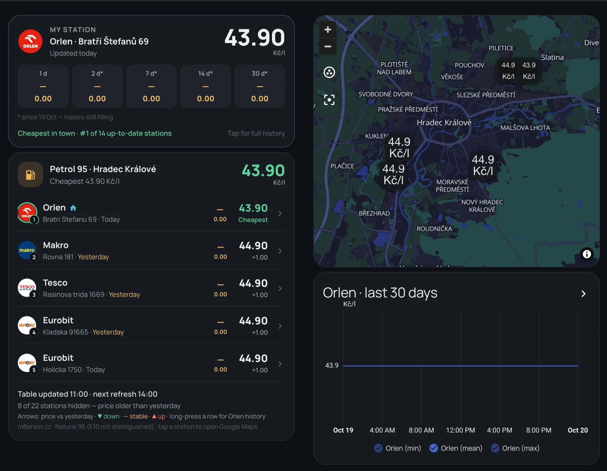

<p align="center"></p>

# ⛽ Ceny paliv – Czech fuel prices for Home Assistant

**English** · [Česky](README.cs.md)

A HACS integration that shows the cheapest stations of **your city** for the fuel(s) you use — **Natural 95, Diesel, LPG, CNG** and more — plus **your favourite station** with price history and trends. Everything is configured from the Home Assistant UI.



> **Ceny paliv** (Czech for “fuel prices”) is an independent project. The prices come from [mBenzin.cz](https://www.mbenzin.cz); this project is not made, endorsed or supported by mBenzin.cz.

## Features

- Pick your **city**, one or **several fuels** (e.g. Natural 95 + LPG for a dual-fuel car) and a **favourite station per fuel**
- Per fuel: the **top 5 cheapest** stations in the city (only that city, not the region), with a Google Maps link, and a **map**
- Favourite station: price, **trends vs 1/2/7/14/30 days ago**, rank in town, long-term statistics (the 30-day graph)
- A ready-made **dashboard card** (`ceny-paliv-card`) shipped with the integration — add it from the card picker, no YAML to copy — in **English or Czech** (your choice during setup)
- Stale prices are hidden (older than yesterday for petrol/diesel, 3 days for CNG, 7 days for LPG/AdBlue)

## 1. Get your access key (free)

mBenzin blocks plain scraping with a browser check, but they give a **personal access key** to Home Assistant users. E-mail **reklama@mbenzin.cz** and tell them what the prices are for, which city/stations, and how often you load them. (For me the answer came quickly and the key worked immediately.)

- The key is **personal — never share it or publish it**. Everyone requests their own.
- Limit: **20 pages per hour** per key. This integration makes 4 calls a day per fuel.
- It uses mBenzin's price-map data, which is not a documented public API: be gentle and respect their conditions.

## 2. Install with HACS

1. HACS → ⋮ → **Custom repositories** → add `https://github.com/donthedandy/ha-ceny-paliv`, category **Integration**.
2. Search for **Ceny paliv**, download it, **restart** Home Assistant.
3. Settings → Devices & services → **Add integration** → **Ceny paliv**, then:
   1. paste your **access key**
   2. choose your **city**
   3. choose your **fuel(s)** and the **language** of the dashboard texts (English / Čeština)
   4. for each fuel, choose your **favourite station** from the list of stations of your city (or "—" for none)

You can change the fuels, the language and the favourite stations later: the integration's **Configure** button.

> The setup screens follow Home Assistant's own language (English and Czech are provided). The language chosen in step 3 only sets the labels of the dashboard card.

## Entities

For each fuel `<fuel>` (`n95`, `benzinplus`, `diesel`, `dieselplus`, `lpg`, `cng`, `adblue`):

| Entity | What |
|---|---|
| `sensor.ceny_paliv_<fuel>_top5` | price of the cheapest station; attributes: the 5 stations (name, address, price, coordinates, Google Maps link, trends…) |
| `sensor.ceny_paliv_<fuel>_home` | price at your favourite station (only if you chose one); trends, rank, statistics |
| `sensor.ceny_paliv_<fuel>_1` … `_5` | the 5 cheapest stations, with latitude/longitude for the map card |

The sensors are named after the station they currently show (for example `1 · Orlen – Bratri Stefanu 69`); the entity ids never change. Prices refresh every 6 hours. If a refresh fails (for example HTTP 429) the last data is kept and the attribute `fetch_error` says why.

## 3. The dashboard card (included, nothing else to install)

The integration ships its own card, **`ceny-paliv-card`**. After installing (and restarting) just:

1. Open a dashboard → **Edit** → **Add card** → search **Ceny paliv**.
2. Pick the **fuel** (the visual editor lists the fuels you set up). Done.

Or in YAML:

```yaml
type: custom:ceny-paliv-card
fuel: n95            # n95 | benzinplus | diesel | dieselplus | lpg | cng | adblue
```

One card per fuel: for a dual-fuel car add a second card with `fuel: lpg`. The card shows your favourite station (price, trends, rank), the top 5 with a Google Maps link on tap, a map and the 30-day graph.

| Option | Default | |
|---|---|---|
| `fuel` | – | required |
| `show_map` | `true` | map with the 5 cheapest stations and your favourite one |
| `show_graph` | `true` | 30-day graph of your favourite station |
| `logos` | `[]` | chains that have a logo, e.g. `[orlen, makro, tesco]` |
| `logo_path` | `/local/` | where the logos are |

Texts follow the language chosen in the setup. Logos are optional: put round 128 px PNGs named after the chain (`orlen.png`, …) in `config/www/` and list the chains in `logos`; they are trademarks, so none are included. If the card does not show up after an update, reload the browser page (Ctrl+F5).

For a notification when your station's price changes, see `examples/price_alert.yaml`.

## 4. Without the card: standard cards

Every sensor is named after what it currently shows (for example `1 · Orlen – Bratri Stefanu 69`), so any standard card displays the station without a template. The names follow the ranking and update at each refresh; the entity ids never change.

An **Entities** card with the 5 cheapest stations (the sensor state is the price):

```yaml
type: entities
title: Natural 95
entities:
  - sensor.ceny_paliv_n95_1
  - sensor.ceny_paliv_n95_2
  - sensor.ceny_paliv_n95_3
  - sensor.ceny_paliv_n95_4
  - sensor.ceny_paliv_n95_5
```

A **Markdown** card with the address and a Google Maps link:

```yaml
type: markdown
title: Natural 95 – top 5
content: |-
  
  {{ s.rank }}. **{{ s.name }}** – {{ s.street }}: **{{ '%.2f' | format(s.price) }} Kč/l** · [Maps]({{ s.maps }})
  
```

Each station in the `stations` attribute of `sensor.ceny_paliv_<fuel>_top5` has: `rank`, `name`, `street`, `address`, `price`, `lat`, `lng`, `updated`, `maps`, `home` and `trends`. Use the `_home` sensor for your favourite station (its attributes include `rank`, `vs_cheapest` and `trends`).

## Notes

- **E10** is not distinguished by mBenzin: "Natural 95" is the price shown for 95-octane petrol.
- Entity ids are `sensor.ceny_paliv_<fuel>_…`. A second city would get a `_2` suffix.
- The daily price log used for the trends is stored by Home Assistant and fills up over time (a `*` next to a trend in the card marks a trend computed from a shorter history).

## 🇨🇿 Česky

Úplný český popis (získání klíče, instalace přes HACS, senzory, dashboard) najdete v **[README.cs.md](README.cs.md)**. Stručně: klíč zdarma na reklama@mbenzin.cz, HACS → Vlastní repozitáře → `https://github.com/donthedandy/ha-ceny-paliv` (Integrace) → restart → Přidat integraci **Ceny paliv**.

## License

MIT — see [LICENSE](LICENSE).
